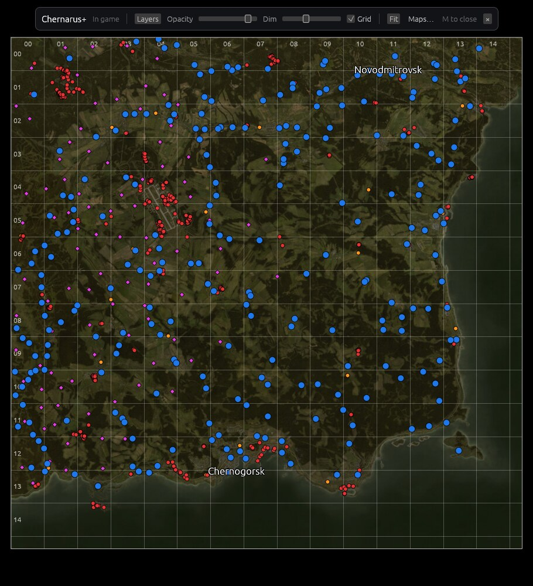
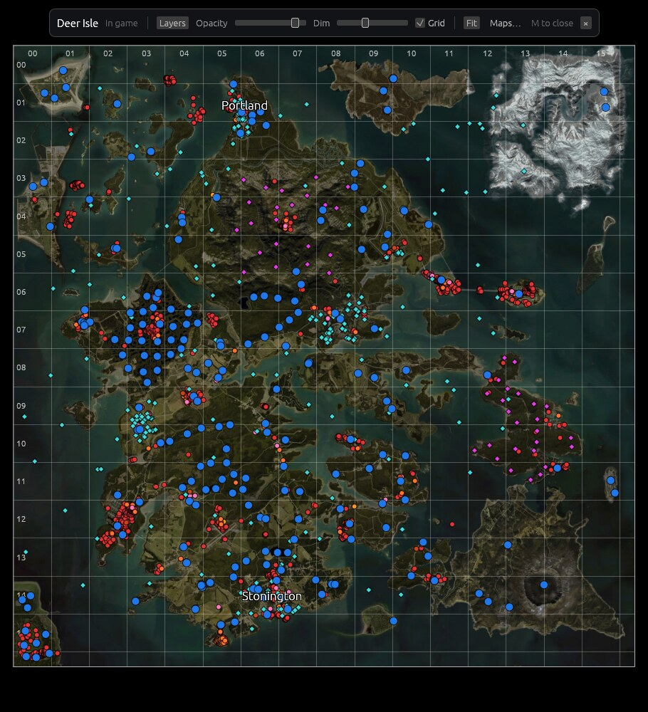
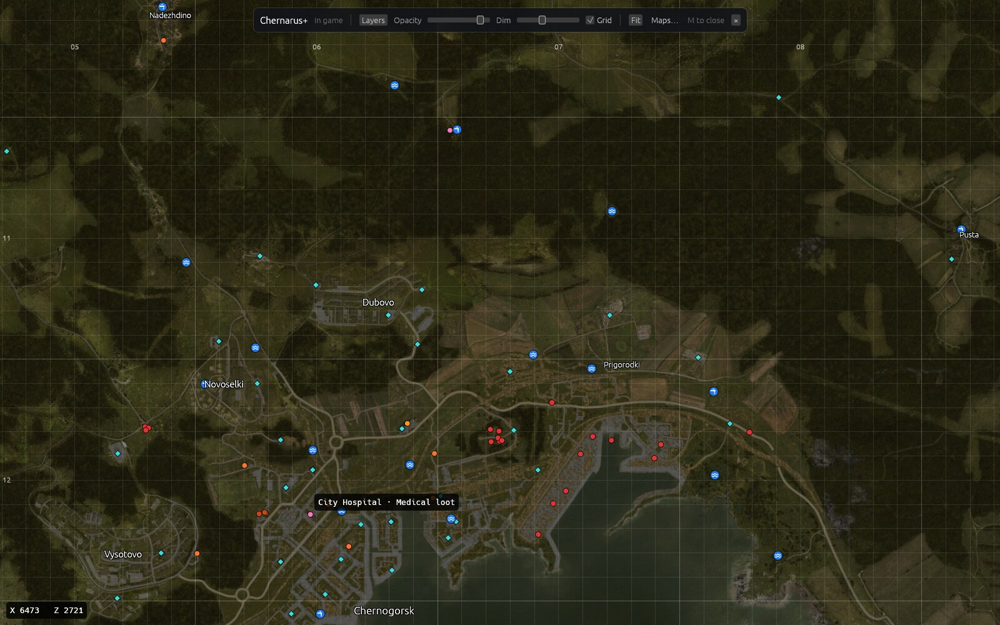
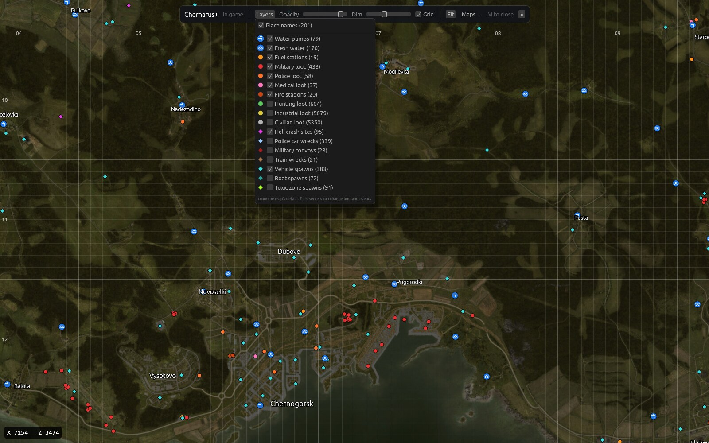
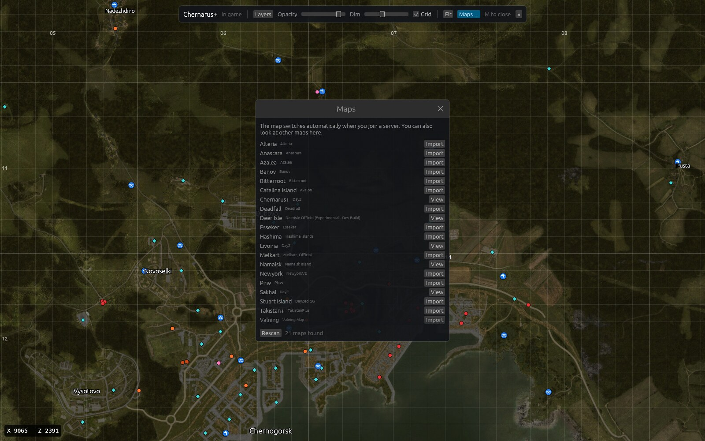

# DayZ Map Overlay

A see-through map that opens over DayZ when you press **M**, similar to the Steam overlay.
It switches to the map of the server you're on by itself, building that map from the game's
own files (or the server's Workshop mods) the first time, and marks points of interest:
towns, water pumps, fuel, loot buildings by type, heli crash sites, vehicle spawns, and more.
You can add your own markers too (home, enemy bases, stashes, ...), saved for the server or the
map.

> **Anti-cheat:** it never reads or changes the game's memory. It reads the game's files and
> logs, draws its own window above the game like the Discord and Steam overlays, and hears the
> hotkey like push-to-talk. See [Anti-cheat](#anti-cheat).

It's written in Rust and runs on Windows 10 and 11, and on Linux desktops that support
layer-shell overlays (KDE Plasma 6, Sway, Hyprland) with DayZ running through Steam/Proton.
For a server browser with the overlay built in, see
[DayZ Server Browser](https://github.com/BrokeAsh/dayz-server-browser).

<p align="center">
  
  
</p>

## Screenshots

Taken without the game running behind the map. In game, DayZ shows through it.

Zoomed in on Chernogorsk with a few more layers on. Hovering a marker names the building:



The Layers menu:



The Maps window, listing the maps found in the game and Workshop folders:



## Requirements

Windows:

- Windows 10 or 11 with DirectX 12.
- DayZ in **borderless** or **windowed** mode. Nothing can draw over exclusive fullscreen.
- DayZ through Steam. It's found through Steam's library list, so there's usually nothing to set.

Linux:

- Linux with a Wayland desktop that supports layer-shell overlays: KDE Plasma 6, Sway,
  Hyprland, and other wlroots desktops. GNOME and X11 sessions aren't supported yet.
- A GPU with Vulkan (any gaming GPU and driver from the last several years).
- DayZ through Steam (Proton). DayZ is found through Steam's library list, including extra
  library drives and the Flatpak and Snap versions of Steam, so there's usually nothing to set.

## Install

### Windows

Download `dayz-map-<version>-windows-x86_64.zip` from the
[releases](https://github.com/BrokeAsh/dayz-map-overlay/releases) and extract it somewhere it can
stay, such as `%LOCALAPPDATA%\Programs\dayz-map`. Then, in a terminal in that folder:

```powershell
.\dayz-map status          # check that it found DayZ, the Workshop folder and the logs
.\dayz-map autostart on    # start when you sign in (`off` to undo)
start .\dayz-map.exe      # or start it now (double-clicking dayz-map.exe works too)
```

Started that way (or at sign-in), the overlay runs in the background without a window of its
own and logs to `%APPDATA%\dayz-map-overlay\data\dayz-map.log`; `dayz-map quit` stops it.
Started as plain `.\dayz-map`, it stays in that terminal and logs there instead, and closing the
terminal stops it. The program isn't signed yet, so the first time you run it Windows may show
"Windows protected your PC": click **More info**, then **Run anyway**.

### Linux

Download `dayz-map-<version>-linux-x86_64.tar.gz` from the
[releases](https://github.com/BrokeAsh/dayz-map-overlay/releases), then:

```sh
tar xzf dayz-map-*-linux-x86_64.tar.gz
install -Dm755 dayz-map-*/dayz-map ~/.local/bin/dayz-map
dayz-map status          # check that it found DayZ, the Workshop folder and the logs
dayz-map autostart on    # start with your desktop (`off` to undo)
dayz-map &               # or start it now
```

`~/.local/bin` must be on your `PATH` for the short commands; the autostart entry uses the full
path either way.

On Arch Linux you can build and install the package instead (it'll be on the AUR once new
accounts can sign up there again), which puts `dayz-map` in `/usr/bin`:

```sh
git clone https://github.com/BrokeAsh/dayz-map-overlay
cd dayz-map-overlay/packaging/aur/dayz-map-overlay-bin
makepkg -si
dayz-map autostart on
```

To update, run `git pull` in that folder and `makepkg -si` again.

To build it yourself, install Rust (1.95 or newer) and the Wayland and xkbcommon development packages
(`libwayland-dev libxkbcommon-dev pkg-config` on Debian and Ubuntu), then run `cargo build --release`.

## Use

Join a server and press **M**. The first time you join a map it takes a couple of seconds
(during the loading screen) to build it. Like the Steam overlay, the game stays focused and keeps
running underneath, so the keyboard still goes to DayZ. The map takes the mouse whenever the
game's cursor is free over it. On Windows, DayZ keeps the mouse while it's the active window (the
wheel still zooms the map), so click the map to give it the mouse; until you close it or Alt+Tab
back to the game, keys wait. That click only makes the map active, but DayZ sees it too. The
one time the map takes the keyboard is while you type in the Items search box:

| Action | How |
| --- | --- |
| Pan | drag |
| Zoom | scroll wheel, double-click |
| Reset view | **Fit** |
| Points of interest | **Layers** |
| Where items spawn | **Items…** (see [Finding items](#finding-items)) |
| Your own markers | right-click the map; drag one to move it |
| Other maps | **Maps…** (the overlay switches back when you join a server) |
| Close | **M**, the **×** button, or switching away from the game |

The toolbar shows the map, the server's name and player count (with its queue, if there is
one; updated every 30 seconds), and sliders for map opacity and how much the
game is dimmed. Hover a marker for its name. The cursor's in-game coordinates (X east, Z north,
in metres) show in the bottom-left corner; grid squares count from the north-west corner.

The overlay opens on the monitor the game is on. DayZ must be the focused window, and it works
best in borderless or windowed mode (on Windows, it only works in those). If DayZ binds its own action to M, rebind that action in
the game or change `hotkey`.

Other commands:

- `dayz-map toggle | show | hide | quit` control the running overlay.
- `dayz-map status` shows the folders it found (and how), and what the game is doing: running,
  map, server, and mods.
- `dayz-map autostart on | off` starts the overlay when you sign in, or stops doing that.
- `dayz-map list` shows installed maps and every terrain found in the game and Workshop folders.
- `dayz-map import <world>…` or `--all` builds maps ahead of time.

## Maps

Maps come from the game folder and every Steam library's Workshop folder
(`steamapps/workshop/content/221100`), so new map mods are picked up when you join a server
that uses them. A terrain is assembled from:

- the world archive: the `.wrp` terrain (its size) and `config.bin` (`CfgWorlds`: the world's
  id and place names; some mods, such as Chiemsee, keep the config in another of their
  archives),
- the satellite tiles (`layers\S_XXX_YYY_lco.paa`) and their materials (`P_*.rvmat`), which give
  the tile overlap and where the grid sits,
- the Central Economy files that most maps ship for their default mission (for one that
  doesn't, the base game's).

The world id is the `CfgWorlds` class name, which is what the game reports when it joins a
server. When several mods ship the same terrain (an official and an experimental build, say),
the one the server loads wins. A map is rebuilt when its mod updates. Maps are stored in
`~/.local/share/dayz-map-overlay/maps/<world>/` (on Windows,
`%APPDATA%\dayz-map-overlay\data\maps\<world>\`), about 40–80 MB and one or two seconds each.

For a terrain whose files can't be read, import a picture of the whole map, north up (at most
16384 px across):

```sh
dayz-map import-image mymap mymap.png --world-size 12800 --name "My Map"
```

## Points of interest

| Layer | Source |
| --- | --- |
| Place names | `CfgWorlds >> <world> >> Names` (Chernarus's and Sakhal's Cyrillic names are transliterated); Sakhal and Nasdara encrypt theirs, so the overlay ships a copy taken from the game (see `tools/place-names`) |
| Water pumps and wells (blue, tap icon) | the terrain's `.wrp`: every building whose class the game's or the map mod's scripts make a `Well` (pumps, plus mod additions such as Namalsk's lab sinks) |
| Fresh water (blue, wave icon) | the terrain's `.wrp`: pond, lake, river, stream and spring objects, one marker per area (about 400 m) |
| Fuel stations | buildings in `mapgrouppos.xml` |
| Military, police, medical, fire station, hunting, industrial, civilian loot | buildings in `mapgrouppos.xml`, typed by their loot `usage`/`tag` in `mapgroupproto.xml`; for a map without these files (Chiemsee, Deadfall, Bitterroot, ...), the terrain's buildings that the base game's `mapgroupproto.xml` knows |
| Heli crashes, police cars, convoys, trains, vehicle and boat spawns, toxic zone spawns | `cfgeventspawns.xml` |
| Static contaminated zones | `cfgeffectarea.json` |

These are each map's defaults; a server can change its loot and events. On a map without its
own economy files, buildings show what they spawn in the base game, buildings the mod made
itself are missing, and there are no event spawns or zones (`dayz-map list` says "building
loot" for these). On Chernarus this way finds exactly the buildings its own files list. Water comes from the
terrain itself, so it's complete, except on maps whose world file is encrypted (Sakhal, Nasdara), which
fall back to the wells listed in the economy files. Points of interest are rebuilt on their own
(in a second or two) when the importer's version or the map's files change.

## Finding items

**Items…** lists every item the map's loot can spawn, by kind: Guns, Ammo, Magazines,
Attachments, Food, Drinks, Medical, Clothing, Backpacks, Vests, Tools and melee, Tents and
storage, Explosives, Vehicle parts, and Books. Tick a kind, or single items, and the map shows
the buildings they can spawn in as gold dots, bigger and paler where more of them fit. Hover a
dot for the building, its tier, which of your picks spawn there, and how many loot spots can hold
them. Hover an item in the list for the kinds of building and the tiers it spawns in, how many
buildings that is on this map, and whether it also drops at heli crashes and other events. While
items are picked, the loot-building layers are hidden. Your picks are kept between sessions and
maps; **Clear** drops them.

To find one item, click the search box and type part of its name, or of its class name (`akm`
finds the KA-M). That box borrows the keyboard: while you type, DayZ doesn't get the keys (M is
just an m there), and Enter, Esc, or a click elsewhere gives them back. An item's colours (a
backpack's, say) share one line.

An item can spawn in a building when, in the map's economy files:

- the building's usages (from `mapgroupproto.xml`, plus the area's from `areaflags.map`, such as
  Coast or Hunting) include one of the item's (`types.xml`),
- the area's tier (`areaflags.map`) is one the item allows,
- and one of the building's loot containers takes the item's category and tag (shelves, floor,
  ...).

A list that's missing allows anything, and items with a nominal of 0 don't spawn. Buildings in
the static contaminated zones also take ContaminatedArea loot. Names and kinds come from the
game's item configs and string table. These are the map's defaults: many servers change
`types.xml` (more Mosins, modded items) and their changes can't be seen from outside. The game
also checks that an item physically fits a spot, which isn't modelled here, so a rifle can show
on a small shelf. A map without its own economy files uses the base game's items and building
loot, without tiers.

## Your markers

Right-click the map to put your own marker there: **Home**, **Enemy base**, **Friendly base**,
**Stash**, **My vehicle**, **Danger**, **Meeting point**, **Where I died**, or under **Map
features** any kind of point of interest the map has (water pump, military loot, heli crash,
and so on).

The switch at the top of that menu says where the marker belongs. To the left (**Server**), it's
saved for the server you're on and only shows while you play there, ringed in gold. To the right
(**Map**), it's saved for the map and shows on every server with that map, ringed in white. The
switch stays where you leave it; it's on Map when you're not on a server (or are looking at
another map than the one you're playing).

There's no typing, so the game keeps the keyboard: markers are numbered by kind ("Enemy base 2").
Right-click a marker to give it a name from a list (Main, Backup, Raided, Abandoned, North, ...),
change its kind, move it between the server and the map, or delete it, and drag it to move it.
**Layers** shows or hides each group. Markers are saved in `markers.json` in the data folder
(next to `maps`), after every change.

## Settings

`~/.config/dayz-map-overlay/config.toml` (on Windows,
`%APPDATA%\dayz-map-overlay\config\config.toml`) is written when the overlay closes:

```toml
hotkey = "m"                                  # a character or f1–f24 (on Linux: a Latin character such as ö,
                                              # or a keysym like 0x6d for other scripts)
window_match = ["steam_app_221100", "dayz_x64.exe"]  # opens only when the focused window's
                                              # class or title contains one; one ending in .exe
                                              # must be the program itself (Windows default:
                                              # ["dayz_x64.exe"])
# game_dir = "/path/to/steamapps/common/DayZ" # only if DayZ isn't found automatically
# log_dir = "/path/to/DayZ/logs"              # only if `dayz-map status` can't find the logs

[view]
map = "chernarusplus"   # last map shown
map_opacity = 0.9
backdrop_opacity = 0.35
show_grid = true
show_places = true
show_server_markers = true   # your markers for the server you're on
show_map_markers = true      # your markers for the whole map
markers_for_map = false      # the Server/Map switch when adding a marker (false: Server)

[view.layers]           # point-of-interest layers you switched on or off
civilian = false
```

If DayZ isn't in any Steam library, the Maps window says so and offers **Choose the DayZ
folder…**, which saves `game_dir` for you. The Workshop folder and the logs are then worked out
from the game's library (or from the game's `!Workshop` links), so `log_dir` is rarely needed.
`DAYZ_MAP_LOG_DIR` overrides the log folder for one run (useful for testing with recorded logs).

## Troubleshooting

- **M does nothing (Windows):** check that DayZ is in borderless or windowed mode, then look in
  `dayz-map.log` (see [Install](#windows)). It logs `hotkey in "…": toggling the map` for every
  press while the overlay runs; `…: not the game` means `window_match` doesn't match the game's
  window (the text in quotes is what to match). If DayZ runs as administrator, the overlay must
  too: Windows doesn't pass keys from an elevated window to a normal one.
- **M does nothing (Linux):** run `dayz-map` in a terminal, focus DayZ, and press M. It logs
  `hotkey in "…": toggling the map` for every press; if nothing appears, the key isn't reaching
  it (for example with Proton's experimental Wayland mode, `PROTON_ENABLE_WAYLAND=1`). As a
  workaround, bind `dayz-map toggle` to a key in your desktop's shortcut settings. The overlay
  then can't tell when you switch away from the game, so close it with the same key. If it logs
  `hotkey ignored: DayZ itself isn't running`, check that `dayz-map status` shows the game
  running (M does nothing in the launcher on purpose).
- **Scrolling doesn't zoom (Windows):** turn on "Scroll inactive windows when I hover over
  them" in Settings > Bluetooth & devices > Mouse (Windows 10: Settings > Devices > Mouse; on by
  default). Until you click it, the map isn't the active window, so Windows only sends it the
  wheel with that setting.
- **The map doesn't follow the server:** `dayz-map status` should show a Logs folder and, while
  you're on a server, the map and server name.
- **A map is missing:** `dayz-map list` shows every terrain found; Rescan in the Maps window
  picks up newly downloaded mods.

## Anti-cheat

DayZ uses BattlEye. The overlay doesn't read or write the game's memory, load anything into
it, hook its graphics, or send it input. What it does:

- Reads the game's files (once per map) and its `script_*.log` (to tell which server you're on).
- Draws its own see-through window on top of the game, as Discord, Steam, and OBS overlays do.
- Hears the hotkey without blocking it, as push-to-talk does.
- On Windows, checks that DayZ is running and in front by asking Windows for the program's path
  and start time (the most limited access Windows has, which can't read memory). Discord's game
  detection and Task Manager do the same.

Under Proton, BattlEye runs inside Wine and can't see Linux programs at all. On Windows it can
see every window, and external cheats also draw see-through windows over the game, so there's
no guarantee: BattlEye doesn't publish its rules or approve tools. No ban for this kind of tool
is known, but use it at your own risk.

The map shows only what's in the game files, the same as online maps like iZurvive: terrain,
towns, water, and loot-spawn types. It doesn't show your position, other players, or live
loot. Some community servers ban third-party tools in their rules, so check yours.

## How it works

- **Which map** (`src/game.rs`): DayZ writes `script_<date>.log` in `%LOCALAPPDATA%\DayZ` (on
  Linux, inside its Proton prefix). Each
  mission start logs `Creating Mission: mpmissions\__cur_mp.<world>\mission.c`; `intro.<world>`
  is the main menu. The RPT log's command line has the launcher's `-connect=ip:port:query` and
  `-mod=` list. A Steam server query (A2S_INFO) every 30 seconds fetches the server name and player
  count (the queue from its `lqs` tag), kept only if the server reports the same map. If the game runs with `-nologs`, there's nothing to follow.
- **Library** (`src/library.rs`, `src/import/catalog.rs`): scans the game and Workshop folders
  (archive headers only, about half a second for hundreds of mods), imports the map the game is
  on if it's missing or out of date, and rebuilds maps made by older versions.
- **Overlay window on Linux** (`src/host/wayland.rs`): a full-screen `wlr-layer-shell` surface on the
  `overlay` layer, which compositors draw above fullscreen windows, placed on the monitor with
  the game window. It doesn't take keyboard focus, so the game stays the active window and
  keeps running; clicks on it don't activate it either. The exception is the Items search box:
  while it has focus, the surface asks for the keyboard (exclusive interactivity), and when it
  lets go it asks the window manager, through XWayland's `_NET_ACTIVE_WINDOW`, to make the game
  active again (letting go alone leaves KWin's keyboard with nobody). Its namespace is `on-screen-display`,
  which KWin treats like the volume OSD: it fades in and out rather than animating like a window.
  Rendering is egui on wgpu (Vulkan).
- **Windows** (`src/host/windows.rs`): a topmost, non-activating tool window
  (`WS_EX_NOACTIVATE`) covering the game's monitor, drawn with DirectX 12 through DirectComposition
  so it can be see-through. It opens without taking focus, so DayZ stays the foreground window.
  Windows sends the active window all mouse input (as raw input, which no hook outside the game
  can hold back), and an active DayZ hides the cursor and keeps it in the middle of the screen,
  so the first click on the map makes the overlay the active window and is otherwise dropped;
  closing the map gives focus back to the game. The hotkey comes from raw keyboard input, which
  Windows delivers to background windows without a hook (while you type in the Items search, M
  is a letter instead), and the overlay hides when another window comes to the front.
- **Hotkey on Linux** (`src/trigger/`): Proton games draw through XWayland, which only receives keyboard
  input while one of its windows is focused. The app listens for raw XInput2 key events from
  XWayland and checks the focused window against `window_match`: no key grab, no root access, and
  no false triggers while typing in other apps. Because the game keeps focus, the same listener
  sees the second press that closes the map, and it hides the map when focus leaves the game.
- **Map view** (`src/ui/`): tiles stream from disk on worker threads into an LRU texture cache at
  the pyramid level that matches the zoom. Closing the overlay frees all but the overview tiles.
- **Importer** (`src/import/`): PBO archives (including LZSS-compressed entries), PAA textures
  (DXT1/5 + LZO), rapified configs, `.wrp` world files (header, classed buildings, and the 60-byte object
  table, found by its record shape), and the economy files. `areaflags.map` is a header (cells
  across and down, metres across and down), a 32-bit usage mask per cell, then a tier mask per
  cell: 8 bits, or 4 (low half first) on maps with at most four tiers, such as Livonia. Rows run
  south to north, and the bits follow the order of `cfglimitsdefinition.xml`.

## Not done yet

- Server-specific loot and events (servers don't share their economy files).
- X11-only Linux desktops (the UI and importer are portable; they need a window host).
- GNOME, which doesn't support layer-shell.

## License

Licensed under either of [Apache License 2.0](LICENSE-APACHE) or [MIT](LICENSE-MIT), at your
option.

Maps and points of interest are built on your machine from the game files and mods you
installed; no map data ships with this program. DayZ is a trademark of Bohemia Interactive,
which isn't affiliated with this project.
